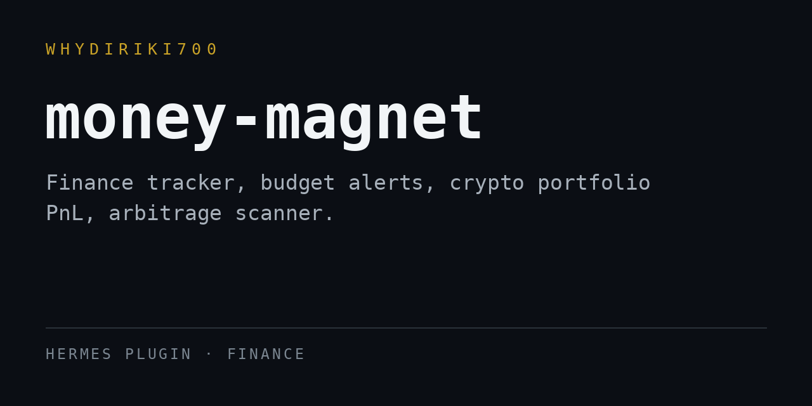

# money-magnet

**Your agent, watching your money.**

money-magnet is a Hermes Agent plugin that gives your agent a small, honest finance desk: it records income and expenses to a local ledger, keeps a monthly budget and reports how much of it is used, tracks a crypto portfolio with live CoinGecko prices and profit/loss, and scans for arbitrage spreads between CoinGecko and Binance. Everything is stored on your own machine; the only network calls are public price lookups.

> **Status:** Submitted to the official Hermes plugin catalog ([NousResearch/hermes-agent#149186](https://github.com/NousResearch/hermes-agent/pull/149186), under review). Built for the Hermes Agent Plugin Hackathon; the demo was recorded from a real Hermes session.

## Tools

- `finance_add` - add income/expense transaction
- `finance_list` - list transactions with filters
- `finance_budget` - set/check monthly budget
- `finance_portfolio` - crypto portfolio PnL (CoinGecko prices)
- `finance_arbitrage` - scan crypto arbitrage opportunities (CoinGecko vs Binance)

## Command

`/money status|add|budget`

## Install

```
hermes plugins install money-magnet --enable
```

## Data and disclosure

Transactions and budget are stored in `$HERMES_HOME/money-magnet/` (transactions.json, budget.json), on your own machine only.

Network calls happen only when you use the market tools: `finance_portfolio` and `finance_arbitrage` query the public CoinGecko and Binance price APIs (no account, no API key, no transaction data is sent, only coin symbols). The tracker tools (`finance_add`, `finance_list`, `finance_budget`) work fully offline.

---

**More by the same author**

- [ProofGate](https://github.com/Whydiriki700/proofgate): no proof, no done. Agent completion claims checked against tool evidence, fail closed.
- [money-magnet](https://github.com/Whydiriki700/money-magnet): finance tracker, budget alerts, crypto portfolio PnL and arbitrage scanner for Hermes Agent.
- [Token Dashboard](https://github.com/Whydiriki700/token-dashboard): live token usage and cost dashboard for Hermes Desktop.
- [Osvyn Hub](https://github.com/Whydiriki700/Osvyn-Hub-Muse): multi-account manager for Muse on Windows.
- Osvyn on Telegram: [t.me/osvynofficial](https://t.me/osvynofficial)
